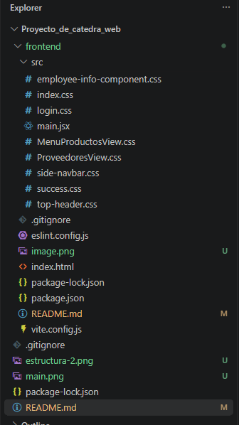
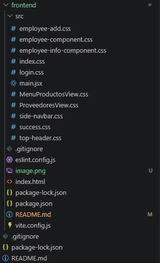
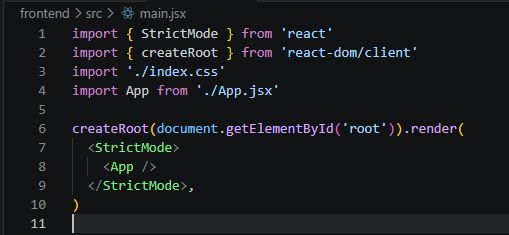
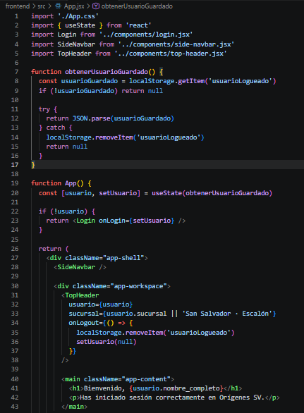
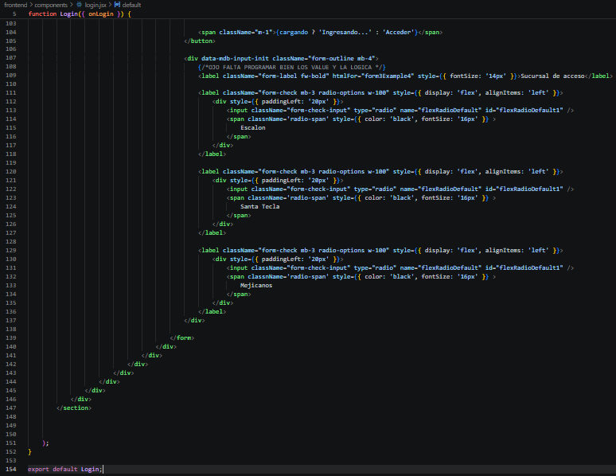

# Orígenes SV · Frontend

## Ejecutar para probar

1. Inicia SQL Server y verifica la configuración `DATABASE_URL` del backend.
2. En una terminal, desde `Backend`, ejecuta `npm run dev`.
3. En otra terminal, desde `frontend`, ejecuta `npm run dev`.
4. Abre la dirección que muestra Vite (por defecto `http://localhost:5173`).

Vite reenvía `/api` al servidor local en `http://localhost:3000`. Si cambias el puerto del backend, actualiza el destino del proxy en `vite.config.js`. Para producción, configura `VITE_API_BASE_URL` con la URL base de la API (por ejemplo, `https://servidor.example/api`); si no se define, se usa `/api`.

El inicio de sesión usa el correo o código de empleado. La sesión obtiene del backend los permisos asignados en la base de datos; la interfaz oculta las opciones no autorizadas y el backend valida el token y el permiso en cada ruta protegida. Las sesiones de desarrollo viven en memoria y se invalidan al reiniciar el backend: vuelve a iniciar sesión.

## Módulos conectados

El menú y las acciones se derivan de los permisos entregados por `/api/session`. El backend sigue siendo la autoridad y vuelve a comprobar cada permiso; ocultar una acción en la interfaz no sustituye esa validación.

- El inventario y las compras administrativas requieren elegir una sucursal; las cuentas con sucursal asignada quedan limitadas a ella.
- La administración de usuarios permite filtrar por sucursal y muestra la asignación del empleado. Los cambios de sucursal se realizan desde la ficha del empleado y se aplican también a su cuenta.
- Ventas y pedidos, reservas y mesas, caja e inventario.
- Compras y proveedores, menú/productos y recetas.
- Empleados, planillas, usuarios, administración de roles/sucursales, reportes y perfil.

Las pantallas consultan la API real, muestran errores y estados vacíos, y no sustituyen los datos por registros ficticios.
# Orígenes SV · Frontend

## Ejecutar para probar

1. Inicia SQL Server y verifica la configuración DATABASE_URL del backend.
2. En una terminal, desde Backend, ejecuta npm run dev.
3. En otra terminal, desde frontend, ejecuta npm run dev.
4. Abre la dirección que muestra Vite (por defecto http://localhost:5173).

Vite reenvía /api al servidor local en http://localhost:3000. Si cambias el puerto del backend, actualiza el destino del proxy en vite.config.js. Para producción, configura VITE_API_BASE_URL con la URL base de la API (por ejemplo, https://servidor.example/api); si no se define, se usa /api.

El inicio de sesión usa el correo o código de empleado. La sesión obtiene del backend los permisos asignados en la base de datos; la interfaz oculta las opciones no autorizadas y el backend valida el token y el permiso en cada ruta protegida. Las sesiones de desarrollo viven en memoria y se invalidan al reiniciar el backend: vuelve a iniciar sesión.

## Módulos conectados

El menú y las acciones se derivan de los permisos entregados por /api/session. El backend sigue siendo la autoridad y vuelve a comprobar cada permiso; ocultar una acción en la interfaz no sustituye esa validación.

- El inventario y las compras administrativas requieren elegir una sucursal; las cuentas con sucursal asignada quedan limitadas a ella.
- La administración de usuarios permite filtrar por sucursal y muestra la asignación del empleado. Los cambios de sucursal se realizan desde la ficha del empleado y se aplican también a su cuenta.
- Ventas y pedidos, reservas y mesas, caja e inventario.
- Compras y proveedores, menú/productos y recetas.
- Empleados, planillas, usuarios, administración de roles/sucursales, reportes y perfil.

Las pantallas consultan la API real, muestran errores y estados vacíos, y no sustituyen los datos por registros ficticios.

## 1.En el apartado del frontend encontramos el archivo de arranque main.jsx:

Importamos StrictMode y createRoot de React para encender la app, traemos los estilos globales de ./index.css y nuestro componente principal ./App.jsx, y al final montamos todo dentro del elemento root de la página.

Lo que toma para avanzar es que exista ese espacio root en la página y que carguen bien ./index.css y ./App.jsx; lo complementa StrictMode revisando que todo esté limpio en desarrollo, y así arranca la pantalla de la aplicación. 

## 2.En App.jsx tenemos el componente principal que revisa si ya hay una sesión guardada y decide qué mostrar:

Traemos useState para manejar el estado del usuario, cargamos App.css y llamamos a Login, SideNavbar y TopHeader; con obtenerUsuarioGuardado revisamos localStorage bajo 'usuarioLogueado' (y si el dato está dañado, lo borramos para evitar fallos).

Lo que toma para avanzar es el dato guardado en localStorage o que Login le pase el usuario al entrar; si no hay usuario te manda a <Login/>, y si ya entró te arma la vista con el menú lateral, el encabezado, la sucursal (con 'San Salvador · Escalón' por defecto) y el saludo con usuario.nombre_completo, complementado con onLogout que limpia todo al cerrar sesión y los estilos de App.css.

## 3.Inicio de sesión (components/login)
En components/login.jsx tenemos el formulario para iniciar sesión contra el backend:

Traemos useState para guardar el correo, la contraseña, el mensaje de error y si está cargando, importamos los estilos de Bootstrap y ../src/login.css, y con manejarLogin evitamos que se recargue la página y mandamos los datos por POST a http://localhost:3000/api/login

Lo que toma para avanzar es que el usuario llene los campos requeridos (correo y password) y que el servidor responda bien; si todo sale bien guarda datos.usuario en localStorage bajo 'usuarioLogueado' y llama a onLogin, y si algo falla muestra un mensaje de error en pantalla, complementado con las opciones visuales de sucursal (Escalon, Santa Tecla, Mejicanos) y el estado cargando que desactiva el botón mientras envía.