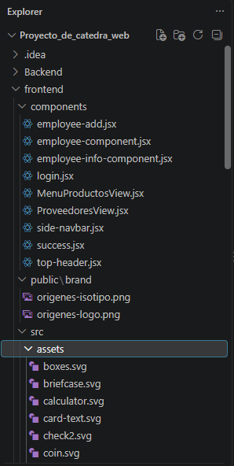
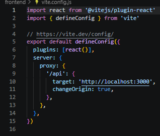
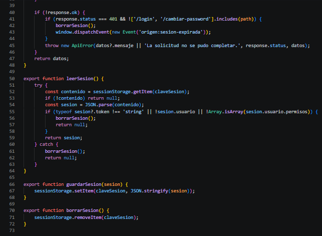
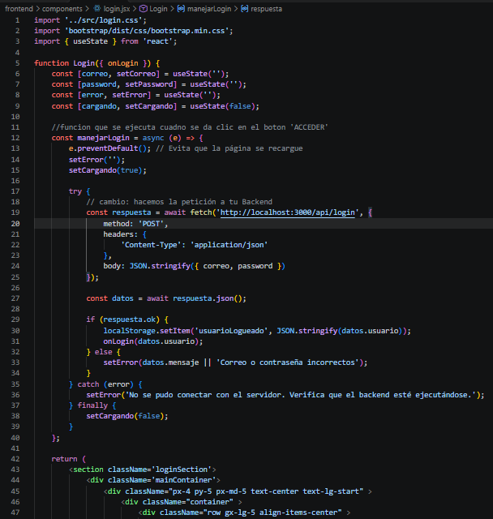
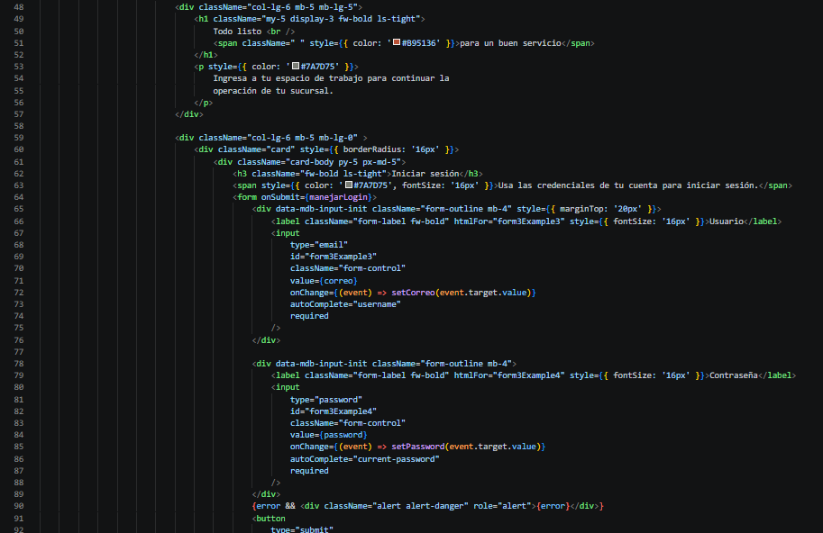

# Orígenes SV · Frontend

## Ejecutar para probar

1. Inicia SQL Server y verifica la configuración DATABASE_URL del backend.
2. En una terminal, desde Backend, ejecuta npm run dev.
3. En otra terminal, desde frontend, ejecuta npm run dev.
4. Abre la dirección que muestra Vite (por defecto http://localhost:5173).

Vite reenvía /api al servidor local en http://localhost:3000. Si cambias el puerto del backend, actualiza el destino del proxy en vite.config.js. Para producción, configura VITE_API_BASE_URL con la URL base de la API (por ejemplo, https://servidor.example/api); si no se define, se usa /api.

El inicio de sesión usa el correo o código de empleado. La sesión obtiene del backend los permisos asignados en la base de datos; la interfaz oculta las opciones no autorizadas y el backend valida el token y el permiso en cada ruta protegida. Las sesiones de desarrollo viven en memoria y se invalidan al reiniciar el backend: vuelve a iniciar sesión.

## Módulos conectados

El menú y las acciones se derivan de los permisos entregados por /api/session. El backend sigue siendo la autoridad y vuelve a comprobar cada permiso; ocultar una acción en la interfaz no sustituye esa validación.

- El inventario y las compras administrativas requieren elegir una sucursal; las cuentas con sucursal asignada quedan limitadas a ella.
- La administración de usuarios permite filtrar por sucursal y muestra la asignación del empleado. Los cambios de sucursal se realizan desde la ficha del empleado y se aplican también a su cuenta.
- Ventas y pedidos, reservas y mesas, caja e inventario.
- Compras y proveedores, menú/productos y recetas.
- Empleados, planillas, usuarios, administración de roles/sucursales, reportes y perfil.

Las pantallas consultan la API real, muestran errores y estados vacíos, y no sustituyen los datos por registros ficticios.

La estructuracion del Frontend ha venido con establecinedo esta logica

## 1.En el apartado del frontend encontramos el archivo de arranque main.jsx:

Importamos StrictMode y createRoot de React para encender la app, traemos los estilos globales de ./index.css y nuestro componente principal ./App.jsx, y al final montamos todo dentro del elemento root de la página.

Lo que toma para avanzar es que exista ese espacio root en la página y que carguen bien ./index.css y ./App.jsx; lo complementa StrictMode revisando que todo esté limpio en desarrollo, y así arranca la pantalla de la aplicación. 

## 2. Archivos base de configuración

Antes de entrar en la lógica de React, el proyecto cuenta con una estructura de archivos que permiten que todo funcione. En la raíz de la carpeta frontend encontramos el index.html, que es el punto de entrada de la aplicación y carga las fuentes oficiales de la marca (Manrope y Quicksand), el favicon y el espacio donde se monta React.

También tenemos el package.json, que define las dependencias del proyecto (como React 19 y Bootstrap), y el vite.config.js, que se encarga de configurar el proxy para redirigir las peticiones de /api hacia el servidor en http://localhost:3000 durante el desarrollo.

Lo que toma para avanzar es tener las dependencias instaladas (con npm install) y que la configuración del proxy apunte al puerto correcto donde está corriendo el backend.

## 3. El componente principal App.jsx
En App.jsx tenemos el componente orquestador de toda la aplicación. Traemos useState, useEffect y useMemo para manejar el estado global, la sesión del usuario y los permisos. Importamos la hoja de estilos workspace.css, el componente Login, la barra lateral de navegación, y las distintas páginas del sistema. Usamos la función leerSesion() (que viene de api.js) para recuperar la sesión guardada en el navegador.

La lógica principal es la siguiente: al iniciar, verifica si hay un token guardado. Si no lo hay, te manda directo a la pantalla de <Login />. Si hay una sesión, hace una petición al backend (a la ruta /session) para validar que el token sigue activo y para obtener los permisos más recientes.

Si el servidor responde que el token expiró o es inválido, borra la sesión y te regresa al inicio de sesión. Si todo está bien, arma la pantalla principal dividida en dos: a la izquierda el menú de navegación (que se filtra según los permisos del usuario) y a la derecha el encabezado con los datos del usuario y el contenido de la página seleccionada.

Lo que toma para avanzar es que el backend esté encendido y validando correctamente el token. Si todo fluye, el usuario ve su panel de trabajo; si hay un problema de conexión, se muestra un mensaje de error con la opción de reintentar.

## 4. La conexión con el backend (api.js)
Para no repetir código en cada pantalla, se creó el archivo api.js. Aquí se centraliza toda la comunicación con el servidor. Traemos las variables de entorno de Vite para saber a qué URL mandar los datos, y definimos una clase de error (ApiError) para manejar mejor los mensajes que nos devuelve el backend.

La función principal es solicitudApi(path, { method, body }). Lo que hace es armar la petición, colocarle el token de seguridad (si es que ya iniciamos sesión) y enviarla al servidor. También se encarga de guardar, leer y borrar la sesión en el sessionStorage del navegador.

Lo que toma para avanzar es que el backend reciba la petición correctamente. Si el servidor responde con un error 401 (que significa que el token expiró o no es válido), la función de forma automática borra la sesión y avisa a App.jsx para que redirija al usuario a la pantalla de Login.

## 5. El control de permisos (navigation.js)
El archivo navigation.js es el encargado de decidir qué opciones ve cada usuario en el menú. Aquí definimos un arreglo con todos los módulos del sistema (Inicio, Ventas, Reservas, Caja, Inventario, Compras, Productos, Empleados, Planillas, Usuarios, Administración y Reportes), y a cada uno le asignamos un ícono y la lista de permisos que necesita para mostrarse.

La función modulosPermitidos(permisos) toma los permisos que devolvió el backend al iniciar sesión y filtra el arreglo, dejando solo los módulos a los que el usuario tiene derecho. 

Lo que toma para avanzar es que los permisos que envía el backend coincidan con los nombres que pusimos aquí (por ejemplo, 'ver_empleados' o 'gestionar_productos'). Si un usuario no tiene esos permisos, el módulo simplemente no aparece en su menú.

## 6. Inicio de sesión (components/login.jsx)
En components/login.jsx tenemos el formulario para iniciar sesión contra el backend. Traemos useState para guardar el correo (o código de empleado), la contraseña, el mensaje de error y el estado de carga. También importamos los estilos de Bootstrap y los estilos propios de ../src/login.css.

