# Orígenes SV · Frontend

## Ejecutar para probar

1. Inicia SQL Server y verifica la configuración DATABASE_URL del backend.
2. En una terminal, desde Backend, ejecuta npm run dev.
3. En otra terminal, desde frontend, ejecuta npm run dev.
4. Abre la dirección que muestra Vite (por defecto http://localhost:5173).

Vite reenvía /api al servidor local en http://localhost:3000. Si cambias el puerto del backend, actualiza el destino del proxy en vite.config.js. Para producción, configura VITE_API_BASE_URL con la URL base de la API (por ejemplo, https://servidor.example/api); si no se define, se usa /api.

El inicio de sesión usa el correo o código de empleado. La sesión obtiene del backend los permisos asignados en la base de datos; la interfaz oculta las opciones no autorizadas y el backend valida el token y el permiso en cada ruta protegida. Las sesiones de desarrollo viven en memoria y se invalidan al reiniciar el backend: vuelve a iniciar sesión.

## Módulos conectados

El menú y las acciones se derivan de los permisos entregados por /api/session. El backend sigue siendo la autoridad y vuelve a comprobar cada permiso; ocultar una acción en la interfaz no sustituye esa validación.

- El inventario y las compras administrativas requieren elegir una sucursal; las cuentas con sucursal asignada quedan limitadas a ella.
- La administración de usuarios permite filtrar por sucursal y muestra la asignación del empleado. Los cambios de sucursal se realizan desde la ficha del empleado y se aplican también a su cuenta.
- Ventas y pedidos, reservas y mesas, caja e inventario.
- Compras y proveedores, menú/productos y recetas.
- Empleados, planillas, usuarios, administración de roles/sucursales, reportes y perfil.

Las pantallas consultan la API real, muestran errores y estados vacíos, y no sustituyen los datos por registros ficticios.

La estructuracion del Frontend ha venido con establecinedo esta logica

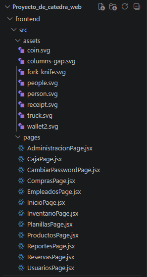

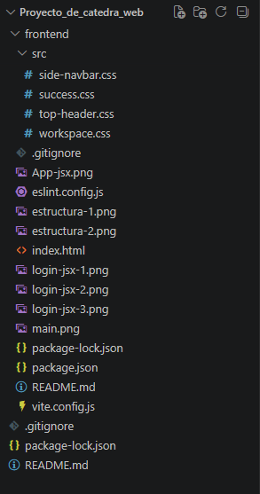
## 1.En el apartado del frontend encontramos el archivo de arranque main.jsx:

Importamos StrictMode y createRoot de React para encender la app, traemos los estilos globales de ./index.css y nuestro componente principal ./App.jsx, y al final montamos todo dentro del elemento root de la página.

Lo que toma para avanzar es que exista ese espacio root en la página y que carguen bien ./index.css y ./App.jsx; lo complementa StrictMode revisando que todo esté limpio en desarrollo, y así arranca la pantalla de la aplicación. 

## 2. Archivos base de configuración

Antes de entrar en la lógica de React, el proyecto cuenta con una estructura de archivos que permiten que todo funcione. En la raíz de la carpeta frontend encontramos el index.html, que es el punto de entrada de la aplicación y carga las fuentes oficiales de la marca (Manrope y Quicksand), el favicon y el espacio donde se monta React.

También tenemos el package.json, que define las dependencias del proyecto (como React 19 y Bootstrap), y el vite.config.js, que se encarga de configurar el proxy para redirigir las peticiones de /api hacia el servidor en http://localhost:3000 durante el desarrollo.
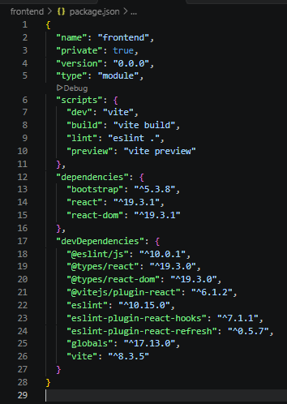

Lo que toma para avanzar es tener las dependencias instaladas (con npm install) y que la configuración del proxy apunte al puerto correcto donde está corriendo el backend.

## 3. El componente principal App.jsx
En App.jsx tenemos el componente orquestador de toda la aplicación. Traemos useState, useEffect y useMemo para manejar el estado global, la sesión del usuario y los permisos. Importamos la hoja de estilos workspace.css, el componente Login, la barra lateral de navegación, y las distintas páginas del sistema. Usamos la función leerSesion() (que viene de api.js) para recuperar la sesión guardada en el navegador.

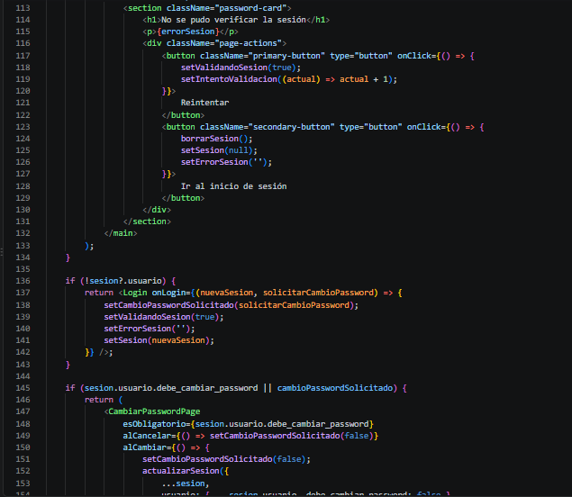

La lógica principal es la siguiente: al iniciar, verifica si hay un token guardado. Si no lo hay, te manda directo a la pantalla de <Login />. Si hay una sesión, hace una petición al backend (a la ruta /session) para validar que el token sigue activo y para obtener los permisos más recientes.

Si el servidor responde que el token expiró o es inválido, borra la sesión y te regresa al inicio de sesión. Si todo está bien, arma la pantalla principal dividida en dos: a la izquierda el menú de navegación (que se filtra según los permisos del usuario) y a la derecha el encabezado con los datos del usuario y el contenido de la página seleccionada.

Lo que toma para avanzar es que el backend esté encendido y validando correctamente el token. Si todo fluye, el usuario ve su panel de trabajo; si hay un problema de conexión, se muestra un mensaje de error con la opción de reintentar.

## 4. La conexión con el backend (api.js)
Para no repetir código en cada pantalla, se creó el archivo api.js. Aquí se centraliza toda la comunicación con el servidor. Traemos las variables de entorno de Vite para saber a qué URL mandar los datos, y definimos una clase de error (ApiError) para manejar mejor los mensajes que nos devuelve el backend.

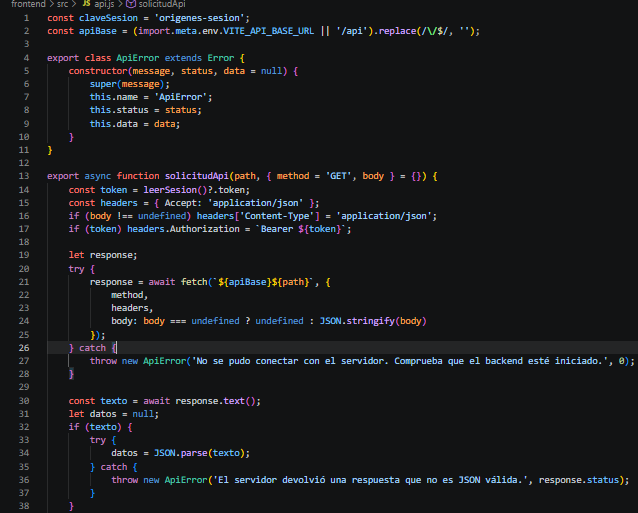

La función principal es solicitudApi(path, { method, body }). Lo que hace es armar la petición, colocarle el token de seguridad (si es que ya iniciamos sesión) y enviarla al servidor. También se encarga de guardar, leer y borrar la sesión en el sessionStorage del navegador.

Lo que toma para avanzar es que el backend reciba la petición correctamente. Si el servidor responde con un error 401 (que significa que el token expiró o no es válido), la función de forma automática borra la sesión y avisa a App.jsx para que redirija al usuario a la pantalla de Login.

## 5. El control de permisos (navigation.js)
El archivo navigation.js es el encargado de decidir qué opciones ve cada usuario en el menú. Aquí definimos un arreglo con todos los módulos del sistema (Inicio, Ventas, Reservas, Caja, Inventario, Compras, Productos, Empleados, Planillas, Usuarios, Administración y Reportes), y a cada uno le asignamos un ícono y la lista de permisos que necesita para mostrarse.

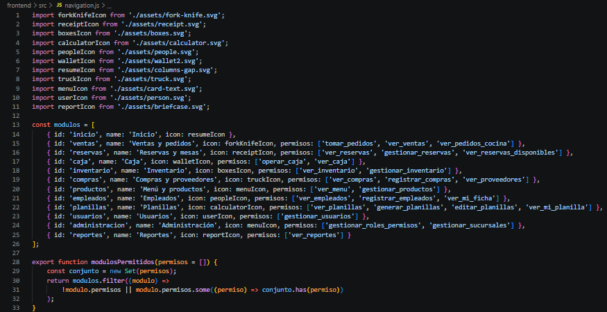

La función modulosPermitidos(permisos) toma los permisos que devolvió el backend al iniciar sesión y filtra el arreglo, dejando solo los módulos a los que el usuario tiene derecho. 

Lo que toma para avanzar es que los permisos que envía el backend coincidan con los nombres que pusimos aquí (por ejemplo, 'ver_empleados' o 'gestionar_productos'). Si un usuario no tiene esos permisos, el módulo simplemente no aparece en su menú.

## 6. Inicio de sesión (components/login.jsx)
En components/login.jsx tenemos el formulario para iniciar sesión contra el backend. Traemos useState para guardar el correo (o código de empleado), la contraseña, el mensaje de error y el estado de carga. También importamos los estilos de Bootstrap y los estilos propios de ../src/login.css.

El formulario tiene un useEffect que se ejecuta al cargar la pantalla. Este se encarga de pedirle al backend la lista de sucursales (usando solicitudApi('/sucursales')) para llenar el menú desplegable, así evitamos tener los datos quemados en el código.

Cuando el usuario da clic en el botón "Acceder", se ejecuta la función manejarLogin. Esta evita que la página se recargue, limpia los errores anteriores y hace la petición al servidor usando solicitudApi('/login', { method: 'POST' }) mandando el correo, la contraseña y el ID de la sucursal.

Lo que toma para avanzar es que el usuario seleccione una sucursal y llene sus datos. Si el servidor responde que todo está bien, se guarda la sesión con la función guardarSesion() (que guarda el token y los permisos) y se le avisa al App.jsx con la función onLogin para que quite la pantalla de login y muestre el sistema. Si falla, se muestra el mensaje de error en un recuadro rojo.

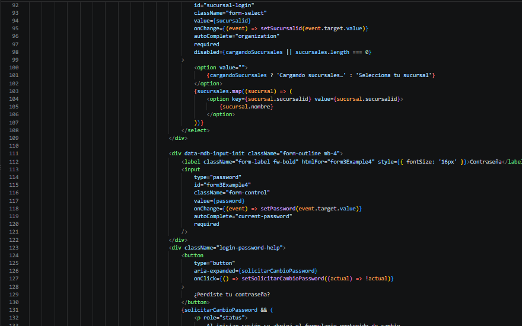

## 7. Menú lateral (components/side-navbar.jsx)
En components/side-navbar.jsx tenemos el menú que aparece a la izquierda de la pantalla una vez que el usuario ya inició sesión. Traemos los íconos de la carpeta de assets, y mostramos el logo principal de Orígenes SV en la parte de arriba.

La lógica es sencilla: el componente recibe por propiedades (props) el arreglo de los items permitidos (que ya filtramos en navigation.js), cuál es el seleccionado actualmente, y las funciones para cambiar de página y para cerrar el menú en celulares. 

Lo que toma para avanzar es que el usuario haga clic en un botón. Al hacerlo, se le avisa a App.jsx para que cambie la página que se está mostrando en el área de contenido. Además, en pantallas pequeñas, el menú funciona como una ventana emergente que se puede cerrar tocando fuera de él.

## 8. Encabezado superior (components/top-header.jsx)

En components/top-header.jsx tenemos la barra superior que muestra la ubicación, la fecha actual y los datos del usuario conectado. Traemos useMemo para calcular la fecha una sola vez cuando carga la pantalla, y la formateamos en español (por ejemplo: "lun, 03 nov 2026").

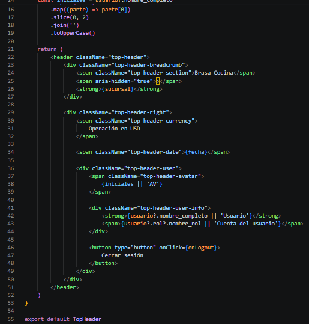

La lógica es tomar el nombre completo del usuario (que viene en las propiedades) y sacar sus iniciales para mostrarlas en un círculo. También mostramos su rol (por ejemplo, Gerente) y el nombre de la sucursal.

Lo que toma para avanzar es que haya un usuario en la sesión. A la derecha hay un botón para "Cerrar sesión", que al darle clic le avisa a App.jsx para que borre la sesión y devuelva a la persona a la pantalla de Login.

## 9. Formulario para agregar empleados (components/employee-add.jsx)

En components/employee-add.jsx tenemos el formulario modal que se abre cuando queremos registrar a un nuevo trabajador en el sistema. Traemos useState para manejar si se está enviando la información (para bloquear el botón) y si ya se completó el registro con éxito. También traemos los íconos en formato SVG (persona, maleta, moneda y tarjeta) que acompañan los títulos de cada sección, y el componente Success que muestra un mensaje de confirmación.

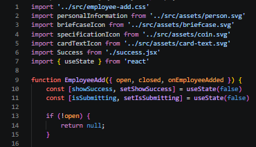

El formulario está dividido en cuatro partes claras: Datos personales (nombre, DUI, fecha de nacimiento, correo y teléfono), Datos de contratación (cargo, sucursal, fecha de ingreso, tipo de contrato y jornada), Detalles salariales (salario y forma de pago) y Afiliaciones laborales (número de ISSS y AFP).

Cuando el usuario da clic en "Registrar Empleado", la función handleSubmit evita que la página se recargue, junta todos los datos escritos y arma un objeto nuevo. Por ahora, en este archivo, se usa un window.setTimeout para simular la respuesta del servidor y se llama a la función onEmployeeAdded que viene desde el componente padre para que lo agregue a la lista. Finalmente se limpia el formulario y se muestra la ventana de <Success />.

Lo que toma para avanzar es que el usuario llene los campos obligatorios. Al darle aceptar en la ventana de éxito, se cierra todo y regresamos a la vista principal de empleados. *(Nota: En la versión conectada al backend, esta parte cambia para usar solicitudApi y guardar los datos directamente en la base de datos, además de generar las credenciales de acceso).*

## 10. Lista y panel de empleados (components/employee-component.jsx)

En components/employee-component.jsx tenemos la vista principal de los empleados. Al inicio del archivo hay un arreglo con datos de prueba (Sergio Perez, Daniel Ricciardo, etc.) para maquetar la pantalla. Traemos useState para controlar el filtro por sucursal, el empleado seleccionado, el texto del buscador y el estado del formulario de registro.

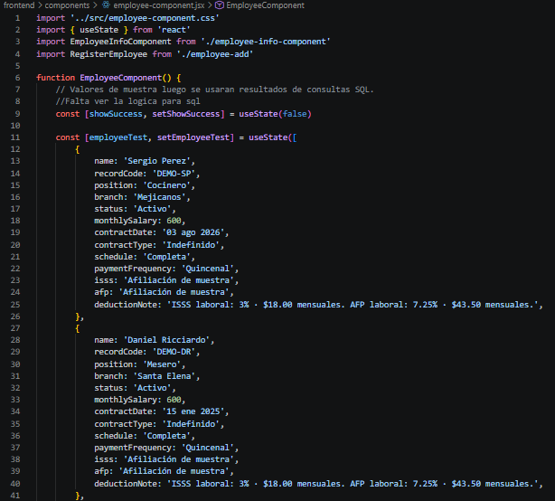

En la parte superior tenemos tres tarjetas de resumen (Personal registrado, Personal activo y Salarios base). Más abajo está la barra de filtros por sucursal y un buscador por nombre. Luego armamos una tabla con los datos básicos de cada empleado.

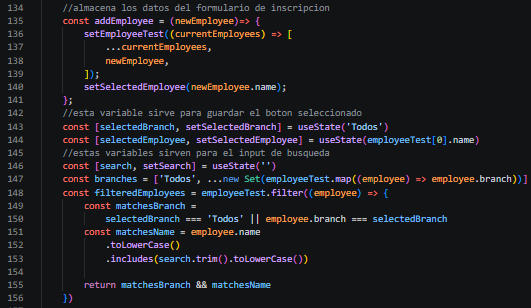

Cuando el usuario hace clic en una fila de la tabla, se marca como seleccionada y el panel de la derecha (donde está el componente EmployeeInfoComponent) cambia para mostrar los detalles de esa persona. También aquí se manda a llamar al formulario de registro de la Parte 9.

Lo que toma para avanzar es que el usuario seleccione un empleado para ver su información o que use los filtros para encontrar a alguien. La tabla calcula los totales y los salarios en el momento, por lo que cualquier cambio en la lista se refleja de inmediato.

## 11. Ficha de detalles del empleado (components/employee-info-component.jsx)

En components/employee-info-component.jsx tenemos la tarjeta que muestra el expediente del empleado seleccionado. Recibe por propiedades el objeto del empleado y arma un arreglo con los detalles a mostrar: fecha de contratación, tipo de contrato, jornada, salario mensual y forma de pago.

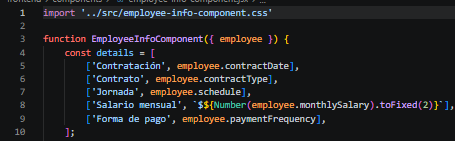

Muestra el nombre grande del empleado, su código de expediente, su puesto y sucursal, además de una etiqueta verde que dice "Activo" o roja si está "Inactivo". Al final, tiene una sección para las afiliaciones de ISSS y AFP, y un botón para editar el expediente (que en el futuro abrirá el formulario con los datos ya cargados).

Lo que toma para avanzar es que haya un empleado seleccionado en la pantalla principal. Si el usuario no tiene seleccionado a nadie, este panel no se muestra. Toda la información se lee de forma automática del objeto del empleado.

## 12. Ventana de éxito reutilizable (components/success.jsx)

En components/success.jsx tenemos un mensaje genérico de confirmación que se usa en distintas partes del sistema (por ejemplo, cuando se registra un empleado). Traemos los estilos de success.css y un ícono de check (una palomita) para indicar que la acción se completó bien.

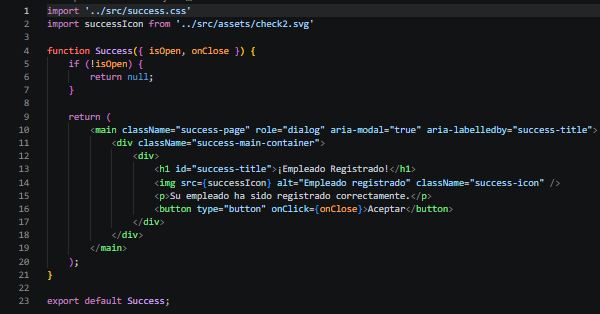

La lógica es muy simple: el componente recibe una propiedad isOpen para saber si debe mostrarse o no, y una propiedad onClose para cerrarlo. Si isOpen es falso, el componente no dibuja nada en pantalla.

Lo que toma para avanzar es que el proceso haya sido exitoso. Al darle clic al botón "Aceptar", se ejecuta onClose, la ventana desaparece y el sistema continúa con su flujo normal.