# Orígenes SV · Frontend

## Ejecutar para probar

1. Inicia SQL Server y verifica la configuración DATABASE_URL del backend.
2. En una terminal, desde Backend, ejecuta npm run dev.
3. En otra terminal, desde frontend, ejecuta npm run dev.
4. Abre la dirección que muestra Vite (por defecto http://localhost:5173).

Vite reenvía /api al servidor local en http://localhost:3000. Si cambias el puerto del backend, actualiza el destino del proxy en vite.config.js. Para producción, configura VITE_API_BASE_URL con la URL base de la API (por ejemplo, https://servidor.example/api); si no se define, se usa /api.

El inicio de sesión usa el correo o código de empleado. El backend guarda la sesión en una cookie `HttpOnly`, `SameSite=Lax` y con `Secure` en producción; el navegador la envía automáticamente y el frontend no almacena el token de sesión. Publica el frontend y la API bajo el mismo sitio para que `SameSite=Lax` funcione. En producción, configura `FRONTEND_ORIGINS` en el backend con los orígenes permitidos separados por comas y usa HTTPS para que el navegador envíe la cookie segura.

La sesión obtiene del backend los permisos asignados en la base de datos; la interfaz oculta las opciones no autorizadas y el backend valida la sesión y el permiso en cada ruta protegida. Las sesiones de desarrollo viven en memoria y se invalidan al reiniciar el backend: vuelve a iniciar sesión.

El aviso de cookies aparece después de iniciar sesión y permite guardar la preferencia para aceptar todas o usar solo las necesarias. Actualmente la cookie de autenticación es la única cookie utilizada; no se cargan cookies de analítica ni publicidad.

## Módulos conectados

El menú y las acciones se derivan de los permisos entregados por /api/session. El backend sigue siendo la autoridad y vuelve a comprobar cada permiso; ocultar una acción en la interfaz no sustituye esa validación.

- El inventario y las compras administrativas requieren elegir una sucursal; las cuentas con sucursal asignada quedan limitadas a ella.
- La administración de usuarios permite filtrar por sucursal y muestra la asignación del empleado. Los cambios de sucursal se realizan desde la ficha del empleado y se aplican también a su cuenta.
- Ventas y pedidos, reservas y mesas, caja e inventario.
- Compras y proveedores, menú/productos y recetas.
- Empleados, planillas, usuarios, administración de roles/sucursales, reportes y perfil.

Las pantallas consultan la API real, muestran errores y estados vacíos, y no sustituyen los datos por registros ficticios.

La estructuracion del Frontend ha venido con establecinedo esta logica

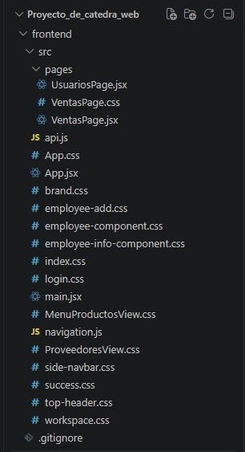

## 1.En el apartado del frontend encontramos el archivo de arranque main.jsx:

Importamos StrictMode y createRoot de React para encender la app, traemos los estilos globales de ./index.css y nuestro componente principal ./App.jsx, y al final montamos todo dentro del elemento root de la página.

Lo que toma para avanzar es que exista ese espacio root en la página y que carguen bien ./index.css y ./App.jsx; lo complementa StrictMode revisando que todo esté limpio en desarrollo, y así arranca la pantalla de la aplicación. 

## 2. Archivos base de configuración

Antes de entrar en la lógica de React, el proyecto cuenta con una estructura de archivos que permiten que todo funcione. En la raíz de la carpeta frontend encontramos el index.html, que es el punto de entrada de la aplicación y carga las fuentes oficiales de la marca (Manrope y Quicksand), el favicon y el espacio donde se monta React.
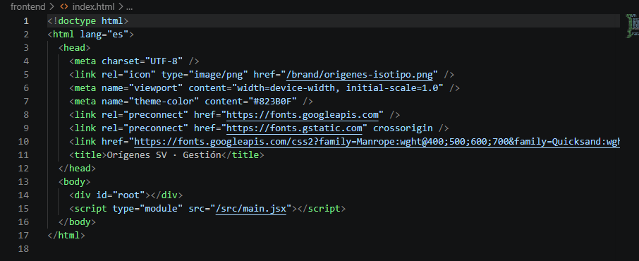

También tenemos el package.json, que define las dependencias del proyecto (como React 19 y Bootstrap), y el vite.config.js, que se encarga de configurar el proxy para redirigir las peticiones de /api hacia el servidor en http://localhost:3000 durante el desarrollo.

Lo que toma para avanzar es tener las dependencias instaladas (con npm install) y que la configuración del proxy apunte al puerto correcto donde está corriendo el backend.

## 3. El componente principal App.jsx
En App.jsx tenemos el componente orquestador de toda la aplicación. Traemos useState, useEffect y useMemo para manejar el estado global, la sesión del usuario y los permisos. Importamos la hoja de estilos workspace.css, el componente Login, la barra lateral de navegación, y las distintas páginas del sistema. Usamos la función leerSesion() (que viene de api.js) para recuperar la sesión guardada en el navegador.

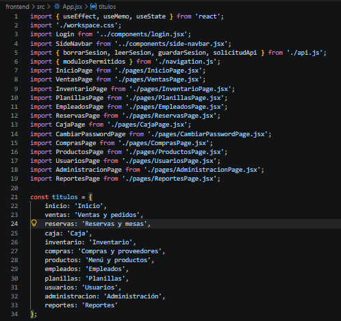
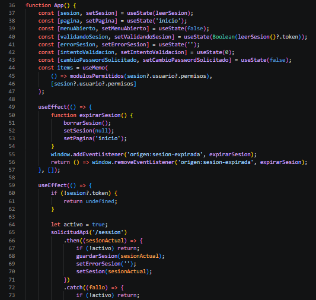
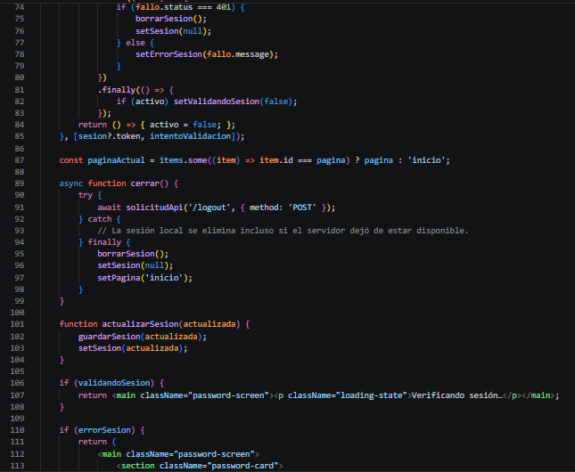

La lógica principal es la siguiente: al iniciar, verifica si hay un token guardado. Si no lo hay, te manda directo a la pantalla de <Login />. Si hay una sesión, hace una petición al backend (a la ruta /session) para validar que el token sigue activo y para obtener los permisos más recientes.

Si el servidor responde que el token expiró o es inválido, borra la sesión y te regresa al inicio de sesión. Si todo está bien, arma la pantalla principal dividida en dos: a la izquierda el menú de navegación (que se filtra según los permisos del usuario) y a la derecha el encabezado con los datos del usuario y el contenido de la página seleccionada.

Lo que toma para avanzar es que el backend esté encendido y validando correctamente el token. Si todo fluye, el usuario ve su panel de trabajo; si hay un problema de conexión, se muestra un mensaje de error con la opción de reintentar.

## 4. La conexión con el backend (api.js)
Para no repetir código en cada pantalla, se creó el archivo api.js. Aquí se centraliza toda la comunicación con el servidor. Traemos las variables de entorno de Vite para saber a qué URL mandar los datos, y definimos una clase de error (ApiError) para manejar mejor los mensajes que nos devuelve el backend.

La función principal es solicitudApi(path, { method, body }). Lo que hace es armar la petición, colocarle el token de seguridad (si es que ya iniciamos sesión) y enviarla al servidor. También se encarga de guardar, leer y borrar la sesión en el sessionStorage del navegador.

Lo que toma para avanzar es que el backend reciba la petición correctamente. Si el servidor responde con un error 401 (que significa que el token expiró o no es válido), la función de forma automática borra la sesión y avisa a App.jsx para que redirija al usuario a la pantalla de Login.

## 5. El control de permisos (navigation.js)
El archivo navigation.js es el encargado de decidir qué opciones ve cada usuario en el menú. Aquí definimos un arreglo con todos los módulos del sistema (Inicio, Ventas, Reservas, Caja, Inventario, Compras, Productos, Empleados, Planillas, Usuarios, Administración y Reportes), y a cada uno le asignamos un ícono y la lista de permisos que necesita para mostrarse.

La función modulosPermitidos(permisos) toma los permisos que devolvió el backend al iniciar sesión y filtra el arreglo, dejando solo los módulos a los que el usuario tiene derecho. 

Lo que toma para avanzar es que los permisos que envía el backend coincidan con los nombres que pusimos aquí (por ejemplo, 'ver_empleados' o 'gestionar_productos'). Si un usuario no tiene esos permisos, el módulo simplemente no aparece en su menú.

## 6. Inicio de sesión (components/login.jsx)
En components/login.jsx tenemos el formulario para iniciar sesión contra el backend. Traemos useState para guardar el correo (o código de empleado), la contraseña, el mensaje de error y el estado de carga. También importamos los estilos de Bootstrap y los estilos propios de ../src/login.css.

El formulario tiene un useEffect que se ejecuta al cargar la pantalla. Este se encarga de pedirle al backend la lista de sucursales (usando solicitudApi('/sucursales')) para llenar el menú desplegable, así evitamos tener los datos quemados en el código.

Cuando el usuario da clic en el botón "Acceder", se ejecuta la función manejarLogin. Esta evita que la página se recargue, limpia los errores anteriores y hace la petición al servidor usando solicitudApi('/login', { method: 'POST' }) mandando el correo, la contraseña y el ID de la sucursal.

Lo que toma para avanzar es que el usuario seleccione una sucursal y llene sus datos. Si el servidor responde que todo está bien, se guarda la sesión con la función guardarSesion() (que guarda el token y los permisos) y se le avisa al App.jsx con la función onLogin para que quite la pantalla de login y muestre el sistema. Si falla, se muestra el mensaje de error en un recuadro rojo.

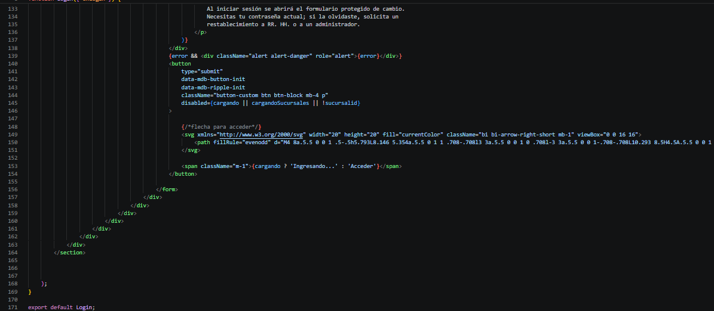

## 7. Menú lateral (components/side-navbar.jsx)
En components/side-navbar.jsx tenemos el menú que aparece a la izquierda de la pantalla una vez que el usuario ya inició sesión. Traemos los íconos de la carpeta de assets, y mostramos el logo principal de Orígenes SV en la parte de arriba.

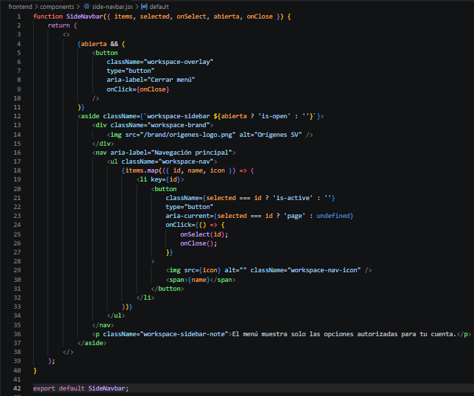

La lógica es sencilla: el componente recibe por propiedades (props) el arreglo de los items permitidos (que ya filtramos en navigation.js), cuál es el seleccionado actualmente, y las funciones para cambiar de página y para cerrar el menú en celulares. 

Lo que toma para avanzar es que el usuario haga clic en un botón. Al hacerlo, se le avisa a App.jsx para que cambie la página que se está mostrando en el área de contenido. Además, en pantallas pequeñas, el menú funciona como una ventana emergente que se puede cerrar tocando fuera de él.

## 8. Encabezado superior (components/top-header.jsx)

En components/top-header.jsx tenemos la barra superior que muestra la ubicación, la fecha actual y los datos del usuario conectado. Traemos useMemo para calcular la fecha una sola vez cuando carga la pantalla, y la formateamos en español (por ejemplo: "lun, 03 nov 2026").

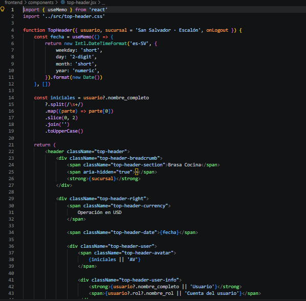

La lógica es tomar el nombre completo del usuario (que viene en las propiedades) y sacar sus iniciales para mostrarlas en un círculo. También mostramos su rol (por ejemplo, Gerente) y el nombre de la sucursal.

Lo que toma para avanzar es que haya un usuario en la sesión. A la derecha hay un botón para "Cerrar sesión", que al darle clic le avisa a App.jsx para que borre la sesión y devuelva a la persona a la pantalla de Login.

## 9. Formulario para agregar empleados (components/employee-add.jsx)

En components/employee-add.jsx tenemos el formulario modal que se abre cuando queremos registrar a un nuevo trabajador en el sistema. Traemos useState para manejar si se está enviando la información (para bloquear el botón) y si ya se completó el registro con éxito. También traemos los íconos en formato SVG (persona, maleta, moneda y tarjeta) que acompañan los títulos de cada sección, y el componente Success que muestra un mensaje de confirmación.

El formulario está dividido en cuatro partes claras: Datos personales (nombre, DUI, fecha de nacimiento, correo y teléfono), Datos de contratación (cargo, sucursal, fecha de ingreso, tipo de contrato y jornada), Detalles salariales (salario y forma de pago) y Afiliaciones laborales (número de ISSS y AFP).

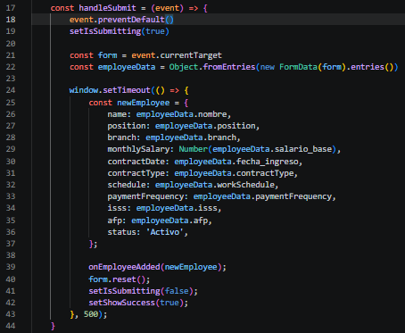

Cuando el usuario da clic en "Registrar Empleado", la función handleSubmit evita que la página se recargue, junta todos los datos escritos y arma un objeto nuevo. Por ahora, en este archivo, se usa un window.setTimeout para simular la respuesta del servidor y se llama a la función onEmployeeAdded que viene desde el componente padre para que lo agregue a la lista. Finalmente se limpia el formulario y se muestra la ventana de <Success />.

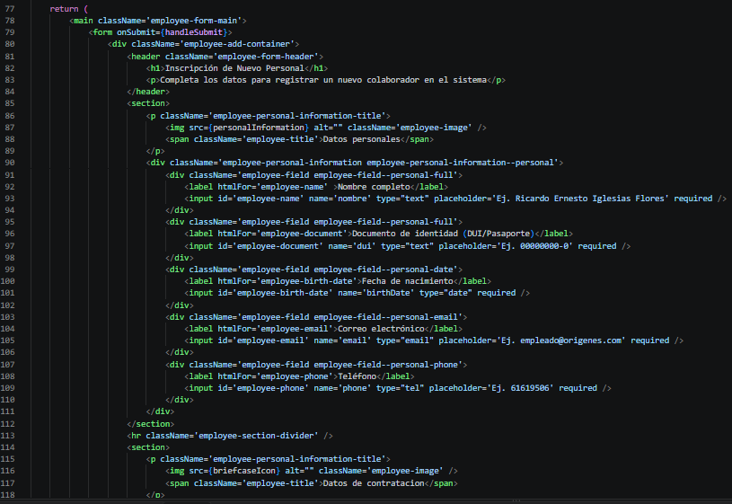

Lo que toma para avanzar es que el usuario llene los campos obligatorios. Al darle aceptar en la ventana de éxito, se cierra todo y regresamos a la vista principal de empleados. *(Nota: En la versión conectada al backend, esta parte cambia para usar solicitudApi y guardar los datos directamente en la base de datos, además de generar las credenciales de acceso).*

## 10. Lista y panel de empleados (components/employee-component.jsx)

En components/employee-component.jsx tenemos la vista principal de los empleados. Al inicio del archivo hay un arreglo con datos de prueba (Sergio Perez, Daniel Ricciardo, etc.) para maquetar la pantalla. Traemos useState para controlar el filtro por sucursal, el empleado seleccionado, el texto del buscador y el estado del formulario de registro.

En la parte superior tenemos tres tarjetas de resumen (Personal registrado, Personal activo y Salarios base). Más abajo está la barra de filtros por sucursal y un buscador por nombre. Luego armamos una tabla con los datos básicos de cada empleado.

Cuando el usuario hace clic en una fila de la tabla, se marca como seleccionada y el panel de la derecha (donde está el componente EmployeeInfoComponent) cambia para mostrar los detalles de esa persona. También aquí se manda a llamar al formulario de registro de la Parte 9.

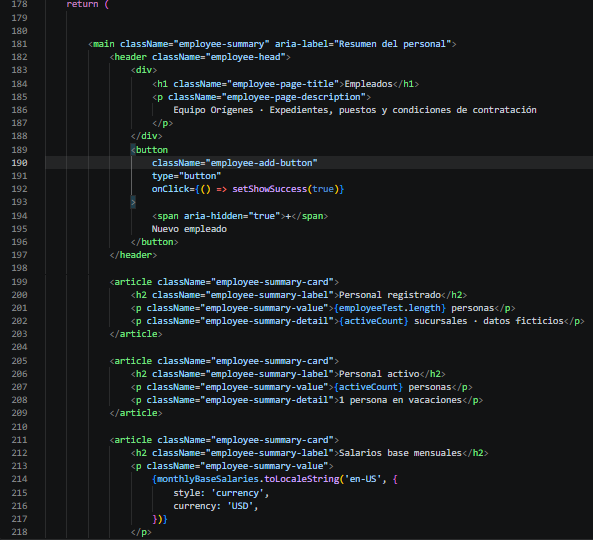

Lo que toma para avanzar es que el usuario seleccione un empleado para ver su información o que use los filtros para encontrar a alguien. La tabla calcula los totales y los salarios en el momento, por lo que cualquier cambio en la lista se refleja de inmediato.

## 11. Ficha de detalles del empleado (components/employee-info-component.jsx)

En components/employee-info-component.jsx tenemos la tarjeta que muestra el expediente del empleado seleccionado. Recibe por propiedades el objeto del empleado y arma un arreglo con los detalles a mostrar: fecha de contratación, tipo de contrato, jornada, salario mensual y forma de pago.

Muestra el nombre grande del empleado, su código de expediente, su puesto y sucursal, además de una etiqueta verde que dice "Activo" o roja si está "Inactivo". Al final, tiene una sección para las afiliaciones de ISSS y AFP, y un botón para editar el expediente (que en el futuro abrirá el formulario con los datos ya cargados).

Lo que toma para avanzar es que haya un empleado seleccionado en la pantalla principal. Si el usuario no tiene seleccionado a nadie, este panel no se muestra. Toda la información se lee de forma automática del objeto del empleado.

## 12. Ventana de éxito reutilizable (components/success.jsx)

En components/success.jsx tenemos un mensaje genérico de confirmación que se usa en distintas partes del sistema (por ejemplo, cuando se registra un empleado). Traemos los estilos de success.css y un ícono de check (una palomita) para indicar que la acción se completó bien.

La lógica es muy simple: el componente recibe una propiedad isOpen para saber si debe mostrarse o no, y una propiedad onClose para cerrarlo. Si isOpen es falso, el componente no dibuja nada en pantalla.

Lo que toma para avanzar es que el proceso haya sido exitoso. Al darle clic al botón "Aceptar", se ejecuta onClose, la ventana desaparece y el sistema continúa con su flujo normal.

## 13. Vista de Menú y Productos (components/MenuProductosView.jsx)

En components/MenuProductosView.jsx tenemos la pantalla para consultar y administrar el catálogo de platillos y bebidas. Al inicio del archivo hay un arreglo llamado CATALOGO_PRODUCTOS con 14 productos de prueba (Hamburguesa Brasa, Pizza margarita, Latte Grande, etc.) que incluyen su categoría, precio, tipo (elaborado o reventa) y disponibilidad. También traemos un arreglo con las sucursales (Escalón, Santa Tecla, Mejicanos).

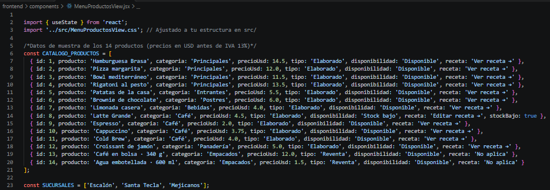

La pantalla tiene una barra superior (topbar) que muestra la marca "Brasa Cocina", la sucursal seleccionada, la fecha y los datos del usuario. Más abajo está el título con el botón "+ Nuevo producto", los filtros por tipo (Todos, Elaborados, Reventa) y un buscador.

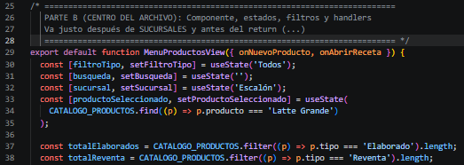

La lógica de los filtros funciona con estados: el usuario selecciona una pestaña o escribe en el buscador, y la lista se actualiza al instante mostrando solo los productos que coinciden. Si un producto tiene "Stock bajo", la fila se pinta de un color diferente para llamar la atención.

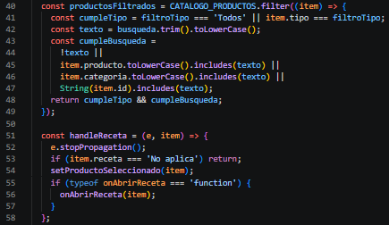

En la tabla, si el producto es de tipo "Elaborado", el botón de "Ver receta" permite seleccionarlo. Al hacer clic en ese botón o en el botón grande de abajo ("Abrir receta"), se ejecuta la función onAbrirReceta que viene desde el componente padre, para que se abra la ventana con los detalles de la preparación. Los productos de "Reventa" (como el café en bolsa) muestran "No aplica" porque no tienen receta.

Lo que toma para avanzar es que el usuario seleccione un filtro o haga una búsqueda. Al final de la tabla hay un pie de página que indica cuántos productos se están mostrando de la lista total, y unas etiquetas que recuerdan las reglas del inventario (los elaborados descuentan insumos, los de reventa descuentan una unidad del producto).

## 14. Vista de Proveedores y Cuentas por Pagar (components/ProveedoresView.jsx)

En components/ProveedoresView.jsx tenemos la pantalla para gestionar los proveedores y llevar el control de las facturas pendientes de pago. Al inicio del archivo definimos tres arreglos: KPI_TARJETAS (con los totales de deudas vencidas, próximas y pendientes), PROVEEDORES_DATA (con los datos de cada proveedor, su contacto y saldo) y FACTURAS_PENDIENTES_DATA (con los detalles de las facturas por pagar).

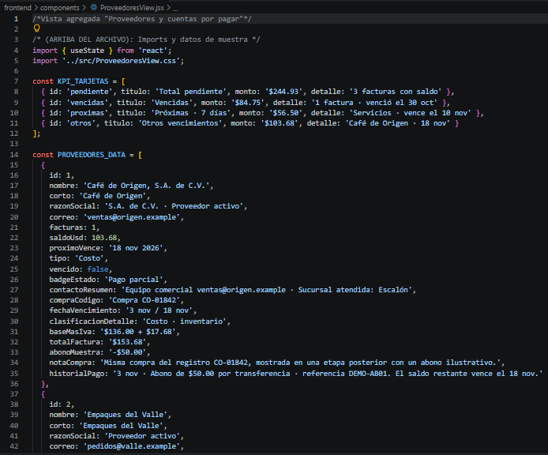

La pantalla está dividida en varios bloques. Arriba tenemos la barra superior con la marca y el usuario, luego el título "Proveedores y cuentas por pagar" con el botón "+ Nuevo proveedor". Debajo hay cuatro tarjetas de resumen (KPI) que muestran los montos totales pendientes, vencidos y próximos a vencer.

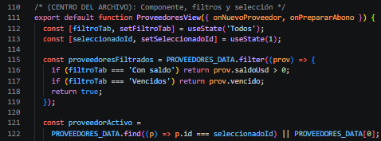

Los filtros (Todos, Con saldo, Vencidos) funcionan igual que en la vista de productos: al seleccionar uno, la tabla de proveedores se filtra. Si el usuario hace clic en una fila de la tabla, se selecciona ese proveedor y el panel de la derecha cambia para mostrar los detalles.

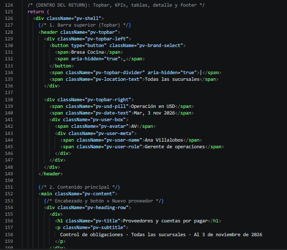

En el panel derecho se muestra el nombre del proveedor, su estado de cuenta (si tiene un pago parcial o si la factura está vencida) y los detalles de la compra: fecha de vencimiento, clasificación (costo o gasto), base más IVA, total de la factura y el abono que se ha hecho.

Lo que toma para avanzar es que el usuario seleccione un proveedor para ver su estado de cuenta. El botón "Preparar abono" ejecuta la función onPrepararAbono que viene desde el componente padre, para que se abra el formulario de pago. En la parte de abajo hay una tarjeta con el historial de pago y el pie de página con las etiquetas de la operación.

## 15. Página de Ventas y Pedidos (pages/VentasPage.jsx)

En pages/VentasPage.jsx tenemos la vista para tomar pedidos en el salón o consultar los que están abiertos. Traemos useState y useEffect para cargar los productos del menú, los modificadores (como "sin cebolla" o "extra queso") y las mesas. La pantalla tiene dos pestañas arriba: "Tomar pedido" y "Pedidos abiertos".

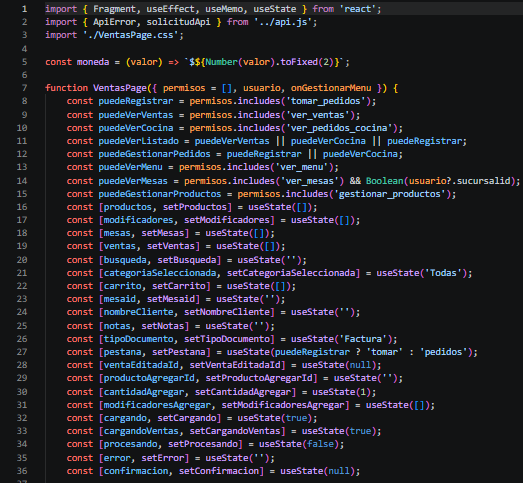

En la pestaña de "Tomar pedido", el mesero selecciona una categoría (Bebidas, Platos fuertes, etc.) y hace clic en un producto para agregarlo al carrito. Si el producto tiene modificadores, se abre un panel para elegirlos. El carrito se va llenando y el sistema calcula el total al instante usando useMemo para evitar errores de redondeo con los centavos.

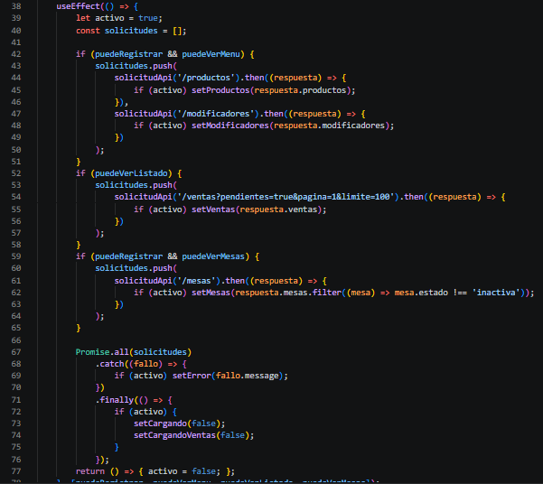

Cuando el mesero da clic en "Registrar pedido", se envía la información al backend usando solicitudApi('/ventas', { method: 'POST' }). El pedido se guarda con el estado 'abierto' y se envía a la cocina. La pestaña de "Pedidos abiertos" muestra la lista de los pedidos que aún no se han cobrado.

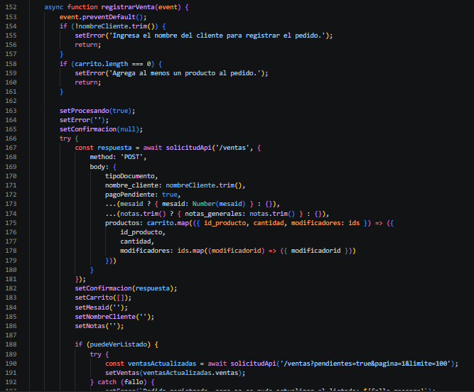

Lo que toma para avanzar es que haya productos en el menú y que el usuario tenga el permiso 'tomar_pedidos'. Si el backend no tiene mesas configuradas, el pedido se guarda como "Para llevar".

## 16. Página de Caja (pages/CajaPage.jsx)

En pages/CajaPage.jsx tenemos la vista para que el cajero abra su turno, cobre las cuentas pendientes y cierre la caja al final del día. Traemos useState para controlar el monto de apertura, el método de pago, y las observaciones de cierre. También cargamos los pedidos pendientes de cobro.

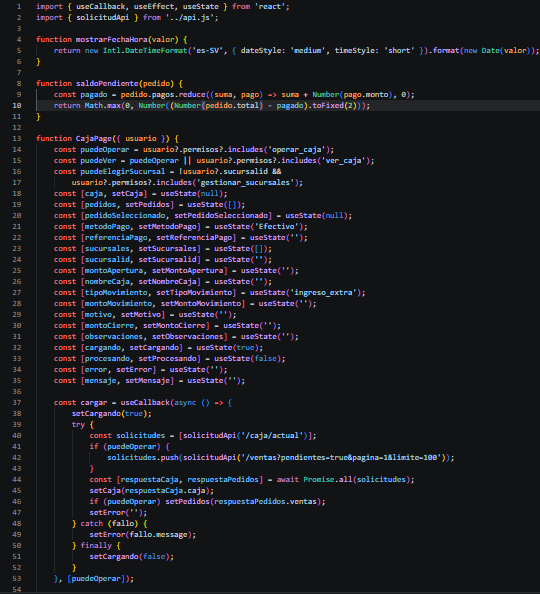

Si no hay una caja abierta, la pantalla muestra un formulario para abrir el turno ingresando el monto inicial. Cuando ya está abierta, se muestra el saldo actual, un formulario para registrar movimientos (ingresos extra, retiros o pagos) y la tabla de movimientos.

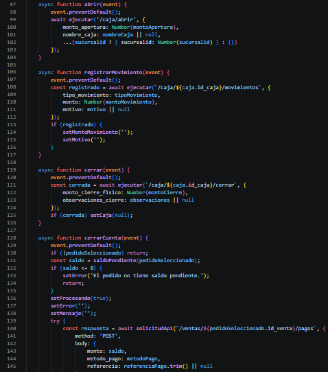

Para cerrar la cuenta de un pedido, el cajero selecciona el pedido de la tabla, elige el método de pago (Efectivo, Tarjeta, Transferencia) y da clic en "Registrar pago y cerrar cuenta". Para cerrar el turno completo, ingresa el efectivo contado y las observaciones, y el sistema hace el cuadre.

Lo que toma para avanzar es que el usuario tenga el permiso 'operar_caja' y que no haya otra caja abierta en la misma sucursal. Si el backend detecta un descuadre en el cierre, lo notifica.

## 17. Página de Inventario (pages/InventarioPage.jsx)

En pages/InventarioPage.jsx tenemos la vista para gestionar los insumos y las existencias. Traemos useState para manejar la lista de insumos, las alertas de stock y los movimientos recientes. Si el usuario es administrador (no tiene sucursal fija), se muestra un selector para elegir qué sucursal revisar.

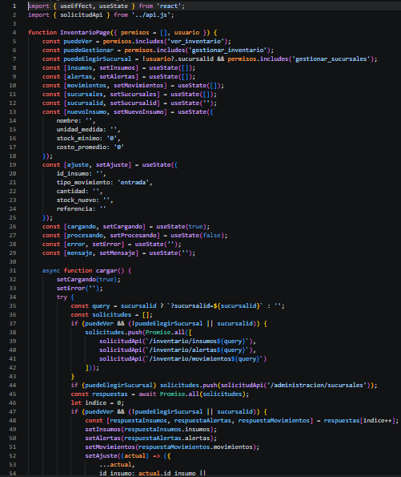

La pantalla tiene tres tarjetas arriba con el resumen: Insumos activos, Alertas de stock y Agotados. Más abajo hay una tabla con las alertas (que se pintan de rojo si está agotado o amarillo si está bajo) y otra tabla con el listado completo de insumos.

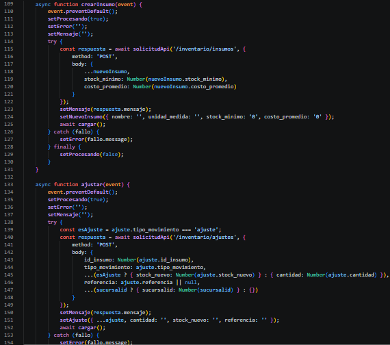

Si el usuario tiene permiso de gestión, se muestran dos formularios: uno para crear un nuevo insumo y otro para ajustar las existencias (entrada, salida o definir el stock exacto). 

Lo que toma para avanzar es que el usuario seleccione una sucursal (si es administrador) y que el backend devuelva los insumos y alertas de esa sucursal. Los movimientos recientes se listan al final para llevar la trazabilidad.

## 18. Página de Compras y Proveedores (pages/ComprasPage.jsx)

En pages/ComprasPage.jsx tenemos la vista para registrar las facturas de compra de los proveedores y que el inventario se actualice. Traemos useState para manejar el formulario de la compra (proveedor, número de factura, IVA) y el detalle del insumo comprado.

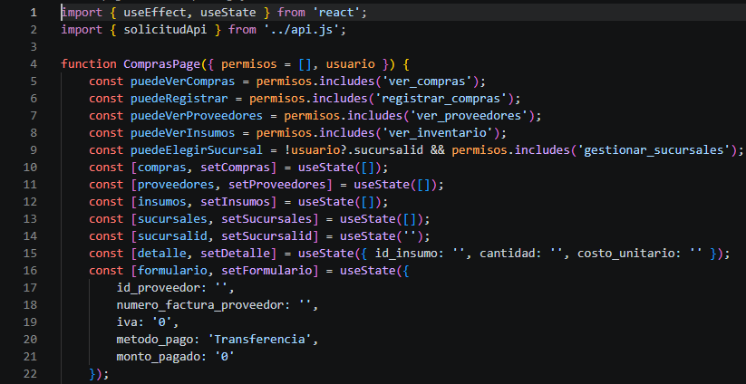

La pantalla tiene una sección para registrar un nuevo proveedor, otra para registrar la compra y, al final, una tabla con las facturas recientes. Si el usuario es administrador, tiene que elegir primero la sucursal.

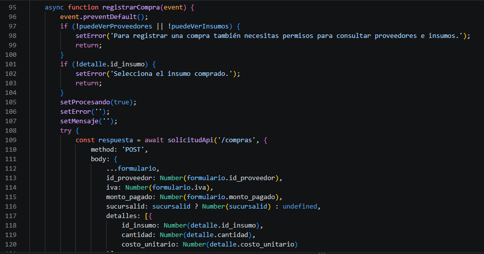

Para registrar una compra, el usuario elige el proveedor, escribe el número de factura, selecciona el insumo, pone la cantidad y el costo unitario. También puede registrar si dejó un pago inicial y con qué método. 

Lo que toma para avanzar es que el usuario tenga los permisos de lectura necesarios para cargar los proveedores e insumos. Al guardar, el backend suma la cantidad al inventario y registra la cuenta por pagar si quedó un saldo pendiente.

## 19. Página de Empleados (pages/EmpleadosPage.jsx)

En pages/EmpleadosPage.jsx tenemos la vista para dar de alta al personal y llevar su expediente completo. Traemos useState para manejar los datos del formulario (nombre, apellidos, DUI, fecha de nacimiento, cargo, salario, fecha de ingreso, tipo de contrato y datos de ISSS y AFP) y useEffect para cargar los roles y las sucursales al entrar a la pantalla.

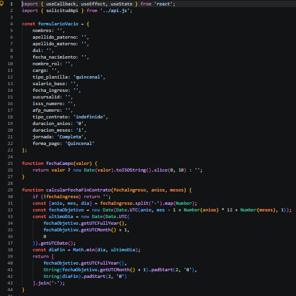

La pantalla está dividida en tres bloques principales. Arriba está el formulario para registrar un nuevo empleado. En medio se muestra la tabla con el personal activo (nombre, código, cargo, rol, sucursal, salario y tipo de contrato). Y al final aparece un mensaje con las credenciales iniciales (correo y contraseña) cuando se registra a alguien, para entregárselas una sola vez.

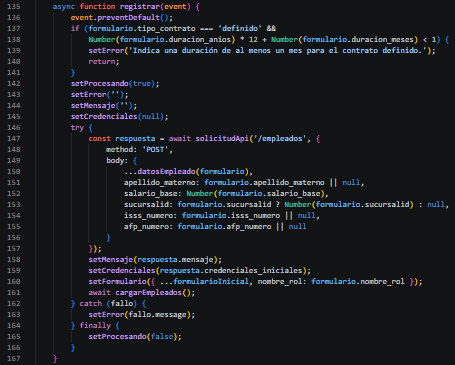

Cuando el administrador hace clic en el botón "Editar" de un empleado de la tabla, el sistema consulta sus datos al backend y llena el formulario de nuevo, pero esta vez en modo edición. Para dar de baja a alguien, se pide una confirmación y el registro no se borra, solo queda inactivo (el historial se conserva).

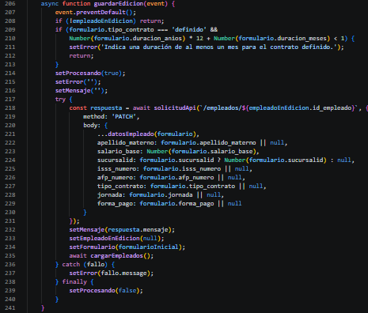

Lo que toma para avanzar es que el usuario tenga el permiso 'registrar_empleados' o 'ver_empleados'. Si el contrato es de tipo "definido", el sistema pide la duración en años y meses y calcula automáticamente la fecha de finalización del contrato.

## 20. Página de Planillas (pages/PlanillasPage.jsx)

En pages/PlanillasPage.jsx tenemos la vista para generar y consultar los pagos del personal. Traemos useState para controlar el período de inicio y fin (que por defecto se calcula como la quincena actual) y las planillas generadas.

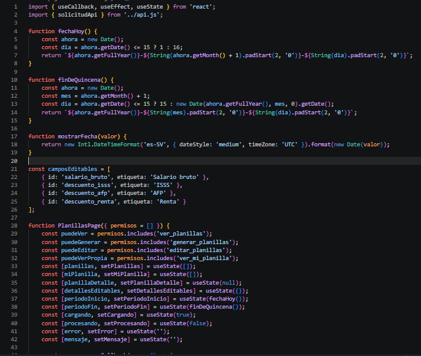

La pantalla tiene una sección para generar una nueva planilla indicando las fechas. Más abajo hay una tabla con los períodos ya registrados, donde se muestra el rango de fechas, el tipo de planilla, el total a pagar y su estado (Pendiente o Pagada). Si el usuario tiene permiso de edición, aparece un botón para modificar los detalles de esa planilla.

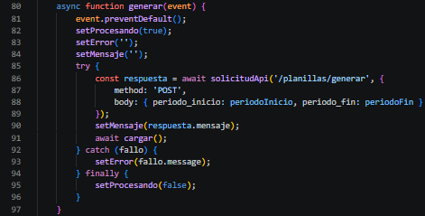

Al abrir la edición de una planilla, se muestra una tabla con cada empleado. El administrador puede ajustar el salario bruto y los descuentos de ISSS, AFP y Renta. El sistema recalcula el salario neto en el momento y, al guardar, actualiza el total de la planilla.

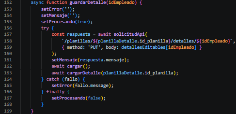

Lo que toma para avanzar es que el usuario tenga el permiso 'ver_planillas' para consultar, y 'generar_planillas' o 'editar_planillas' para crear o modificar. También hay una sección al final llamada "Mis boletas", donde un empleado con el permiso 'ver_mi_planilla' puede ver sus propios pagos.

## 21. Página de Usuarios (pages/UsuariosPage.jsx)

En pages/UsuariosPage.jsx tenemos la vista para administrar las cuentas de acceso al sistema. Traemos useState para manejar el filtro por sucursal y los roles que se le pueden asignar a cada usuario.

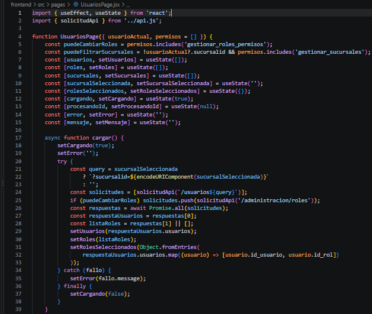

La tabla muestra a cada usuario con su nombre completo, su rol actual, la sucursal a la que pertenece y una etiqueta que indica si está Activo o Inactivo. Al lado de cada fila hay un menú desplegable para cambiar el rol y un botón para desactivar la cuenta (con confirmación previa).

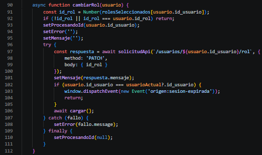

Para evitar errores, el sistema detecta si el usuario que estás viendo es tu propia cuenta. Si lo es, el botón de desactivar y el selector de rol se bloquean, para que no te quites tus propios permisos por accidente.

Lo que toma para avanzar es que el usuario tenga el permiso 'gestionar_usuarios'. Si intentas desactivar a alguien que es el último administrador, el backend rechazará la acción.

## 22. Página de Administración (pages/AdministracionPage.jsx)

En pages/AdministracionPage.jsx tenemos la vista más poderosa del sistema, donde se configuran los roles, los permisos y las sucursales. Traemos useState para manejar los roles, los permisos disponibles, los niveles de acceso y las sucursales.

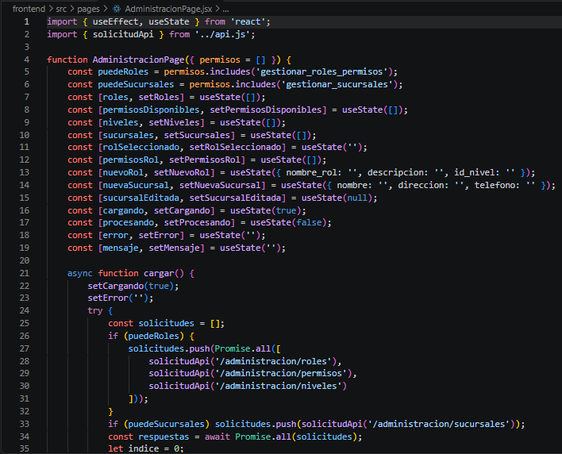

La pantalla se divide en tres grandes bloques. El primero permite crear un rol nuevo, asignándole un nombre, un nivel de acceso (por ejemplo, administrador o mesero) y una descripción. El segundo bloque es para editar los permisos de un rol existente, donde se muestran todos los permisos en casillas para marcarlos o desmarcarlos.

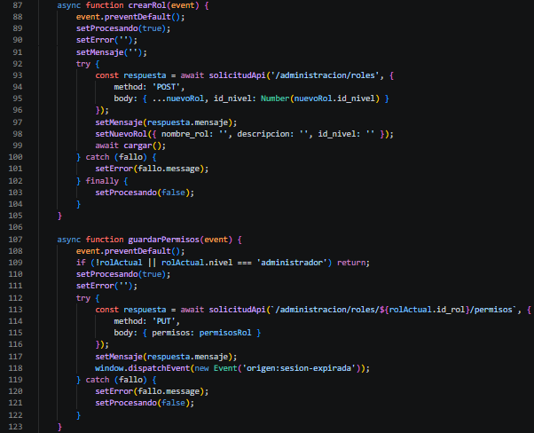

El tercer bloque es para registrar y editar sucursales, donde se piden el nombre, la dirección, el teléfono y el estado (activa o inactiva). 

Lo que toma para avanzar es que el usuario tenga los permisos 'gestionar_roles_permisos' o 'gestionar_sucursales'. Como un cambio en los permisos puede afectar la seguridad, al guardar los permisos de un rol, el sistema cierra la sesión de todos los usuarios activos para que vuelvan a entrar con los permisos actualizados.

## 23. Página de Inicio (pages/InicioPage.jsx)

En pages/InicioPage.jsx tenemos el panel de bienvenida que ve el usuario apenas inicia sesión. Traemos useEffect para consultar el estado de la API (la ruta /health) y mostrar si el sistema está conectado o si hay problemas de red. 

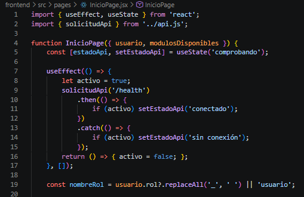

La pantalla muestra un saludo personalizado con el nombre del usuario, su rol y la sucursal en la que está trabajando. Más abajo hay tarjetas con el estado de la sesión, la cantidad de módulos a los que tiene acceso y el estado de conexión con el servidor. Al final de la pantalla se listan todos los módulos permitidos para que el usuario sepa a dónde puede ir.

Lo que toma para avanzar es que el backend esté encendido. Si la API responde bien, la tarjeta de conexión se pinta de verde; si falla, se muestra una alerta amarilla indicando que no hay conexión.

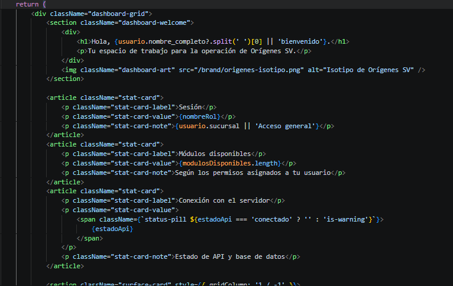

## 24. Página de Reportes (pages/ReportesPage.jsx)

En pages/ReportesPage.jsx tenemos la vista para consultar los reportes de ventas, inventario y planillas. Traemos useState para controlar qué pestaña está activa (Ventas, Inventario o Planillas) y cargar los datos correspondientes desde el backend.

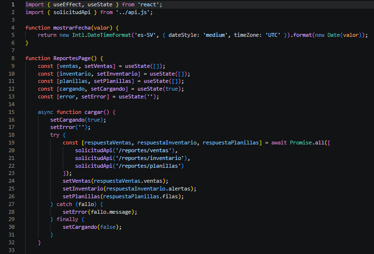

La pantalla muestra una tabla con los datos del reporte seleccionado. En ventas, por ejemplo, se muestra el total vendido por sucursal, la cantidad de transacciones y el tipo de documento. En inventario se muestran los insumos con su stock y costo, y en planillas los pagos realizados. 

Lo que toma para avanzar es que el usuario tenga el permiso 'ver_reportes'. Si no hay datos en el período seleccionado, la pantalla muestra un mensaje indicando que no se encontraron registros.

## 25. Página de Reservas (pages/ReservasPage.jsx)

En pages/ReservasPage.jsx tenemos la vista para gestionar las mesas y las reservas del restaurante. Traemos useState para manejar la fecha y hora de la reserva, la cantidad de personas y la sucursal. También cargamos la lista de mesas disponibles desde el backend.

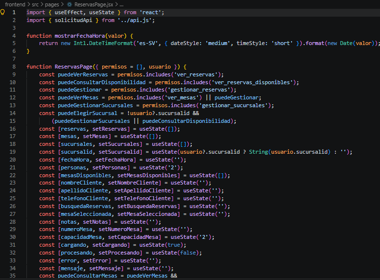

La pantalla tiene una sección para buscar disponibilidad, donde el usuario ingresa la fecha, la hora y cuántas personas van a llegar. Al buscar, el sistema consulta qué mesas están libres y las muestra en una lista. Luego se puede crear la reserva asignando un cliente a esa mesa.

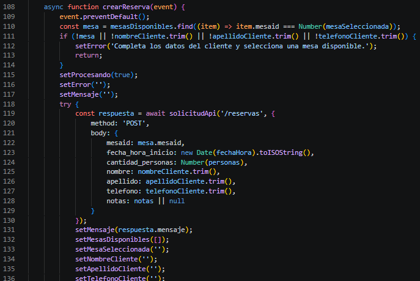

Si el usuario tiene permisos de gestión, también puede ver la lista de todas las reservas (confirmadas, pendientes o canceladas) y cambiar su estado. Para las mesas, hay una sección donde se pueden crear nuevas, marcarlas como ocupadas o liberarlas.

Lo que toma para avanzar es que el usuario elija una sucursal y una fecha válida. Al crear una reserva, el backend valida que la mesa no esté ocupada y que el cliente no tenga otra reserva a la misma hora.

## 26. Archivos de estilos globales y la identidad visual

Todo el sistema utiliza un diseño unificado basado en la identidad de Orígenes SV. En la carpeta src/ encontramos varios archivos .css que se encargan de esto:

- **brand.css**: Define los colores de la marca (el marrón, el naranja y los tonos crema), las fuentes oficiales (Manrope para los títulos y Quicksand para el texto) y las reglas globales para botones, menús y formularios.
- **index.css**: Contiene los estilos base del navegador, resetea los márgenes y define la tipografía por defecto.
- **workspace.css**: Se encarga de la estructura del layout principal (la barra lateral, el encabezado y el área de contenido).
- **login.css, employee-add.css, success.css, MenuProductosView.css, ProveedoresView.css, etc.**: Cada componente o página importante tiene su propio archivo de estilos para que el código sea más fácil de mantener.

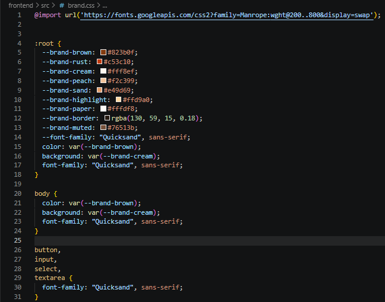

También tenemos la carpeta **assets/**, que guarda los íconos en formato SVG (como las cajas, la calculadora, el carrito, el usuario, etc.) que se usan en el menú lateral y en los formularios. Y la carpeta **public/brand/** guarda los logos oficiales de la empresa (el isotipo y el logo completo).

Lo que toma para avanzar es que estos archivos se importen en los componentes correctos. Si la marca cambia en el futuro, solo hay que modificar las variables en brand.css y todo el sistema se actualizará automáticamente.